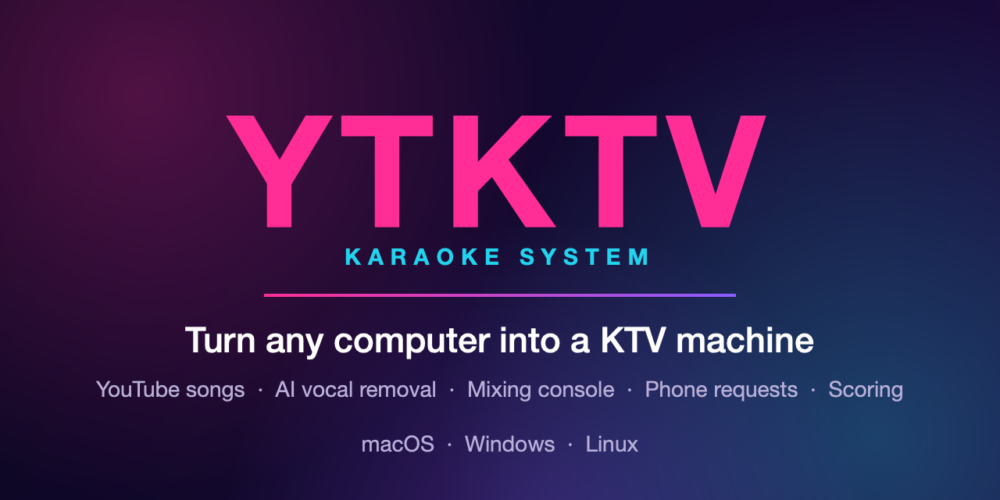
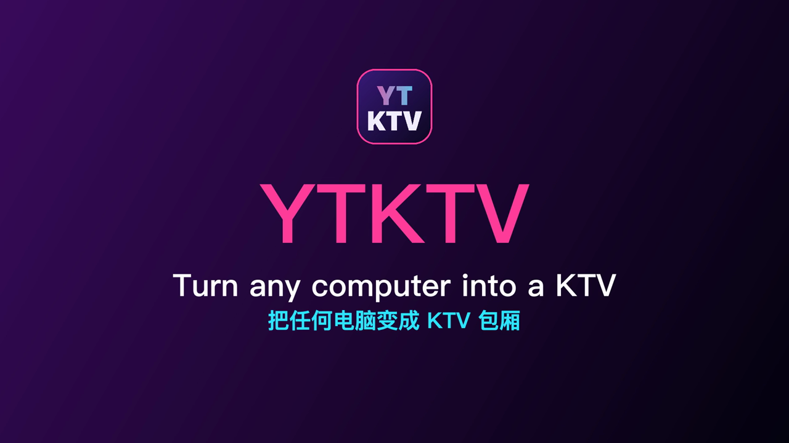
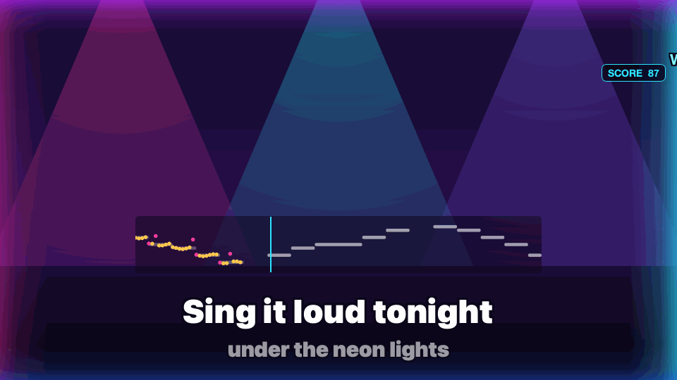
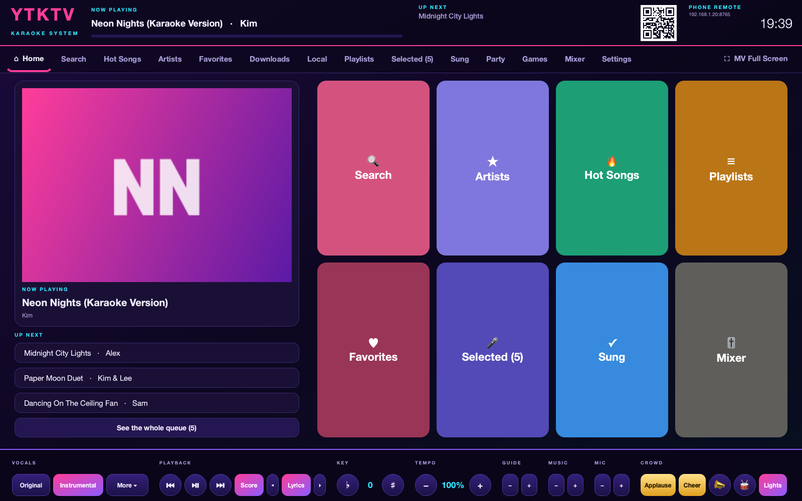
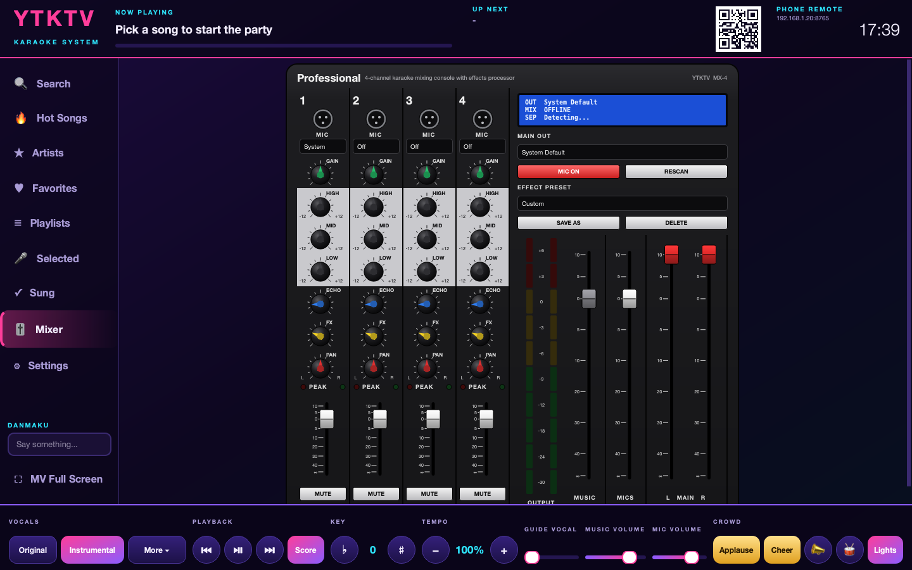
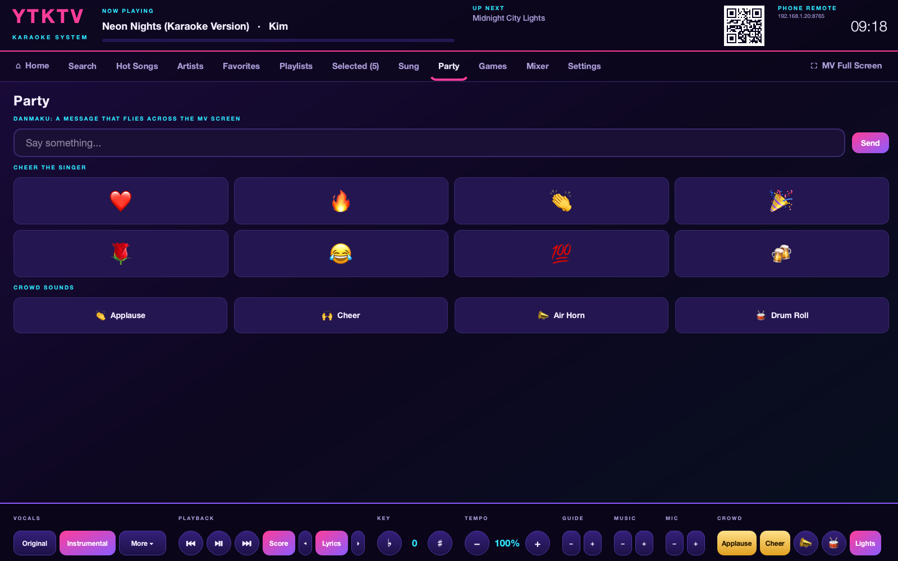
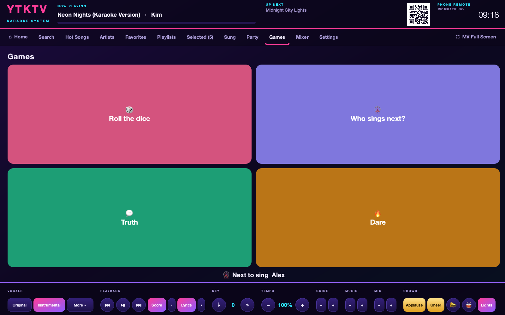
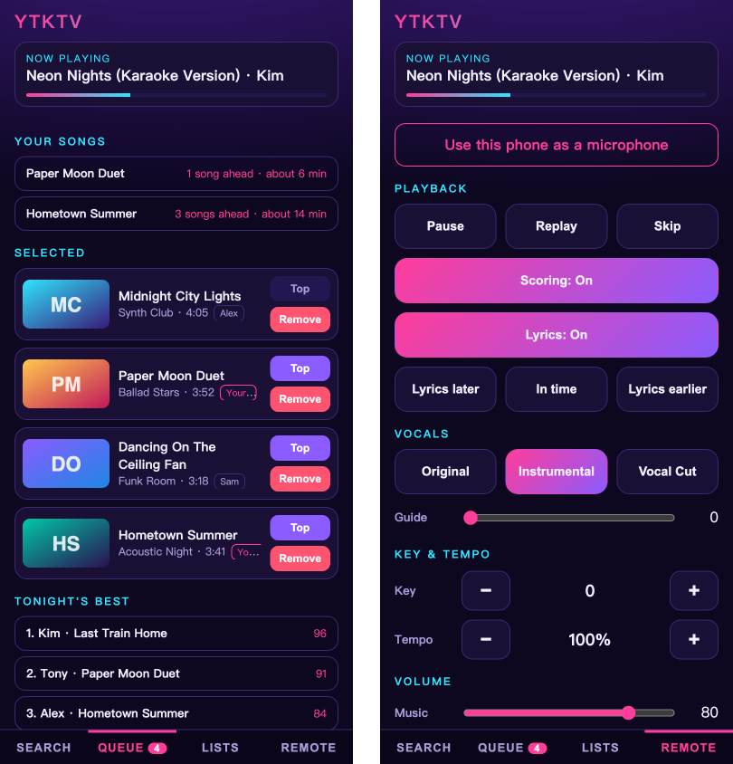
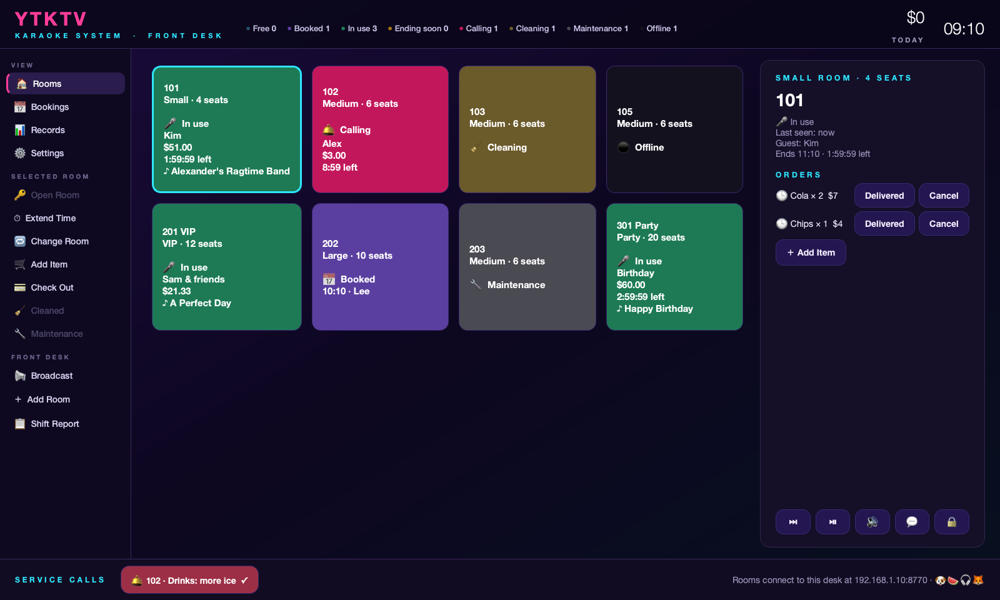

<p align="center">
  
</p>

<p align="center">
  <a href="https://github.com/TonyD365/YTKTV/releases/latest"></a>
  <a href="https://github.com/TonyD365/YTKTV/releases"></a>
  <a href="https://github.com/TonyD365/YTKTV/actions/workflows/ci.yml"></a>
  
  <a href="LICENSE"></a>
</p>

<p align="center">
  <a href="https://github.com/TonyD365/YTKTV/releases/latest"><b>⬇️ Download</b></a> ·
  <a href="https://tonyd365.github.io/YTKTV/">Website</a> ·
  <a href="docs/guide/README.md">User guide</a> ·
  <a href="#quick-start">Quick start</a> ·
  <a href="#features">Features</a> ·
  <a href="#faq">FAQ</a> ·
  <a href="CHANGELOG.md">What's new</a> ·
  <a href="README.zh-CN.md">中文</a> ·
  <a href="https://github.com/TonyD365/YTKTV/issues/new/choose">Report a problem</a>
</p>

**YTKTV turns a computer and a TV into a karaoke room.** Every song on YouTube is in the song
book. The TV shows the music video with karaoke lyrics, an AI takes the singer's voice out of
the song, guests queue songs from their phones (no app to install), and a mixing console that
looks and works like real hardware puts your microphones on top with echo and reverb. Free,
for macOS, Windows and Linux.

<p align="center">
  <a href="https://tonyd365.github.io/YTKTV/images/promo.mp4"></a>
  <br><a href="https://tonyd365.github.io/YTKTV/images/promo.mp4"><b>▶ Watch the 70-second video</b></a>
</p>

<p align="center">
  <a href="https://github.com/TonyD365/YTKTV/releases/latest"></a>
</p>

**Three steps:** 1. download and install it · 2. plug the computer into the TV and open YTKTV ·
3. friends scan the QR code on the TV with their phones and start picking songs.

<p align="center">
  
  <br><sub>The MV screen while someone sings: lyrics that follow the singer, a pitch lane, a live score, danmaku and lights.</sub>
</p>

## Highlights

| | |
|---|---|
| 🎵 **Every YouTube video is a song**<br>Search, paste a link or browse hot songs. Plays without ads. | 🎤 **Original or instrumental, any song**<br>AI vocal removal in the background, on your GPU when there is one. Switch without a gap. |
| 📱 **Phones are the remote, and the microphone**<br>Scan a QR code to queue songs. A phone can even sing into the mixer. | 🎚️ **A mixing console that feels real**<br>Four channels with EQ, compressor, echo, reverb and a feedback guard. |
| 🏆 **Live pitch and scores**<br>See your voice against the tune as you sing, then tonight's leaderboard. Duets score each singer. | ✨ **The KTV atmosphere**<br>Karaoke lyrics, guide vocal, key and tempo, danmaku, applause buttons, lights and party games: number bomb, liar's dice, truth or dare, random song and more. |

| The song console | The mixing console |
|---|---|
|  |  |
|  |  |

<p align="center">
  
  <br><sub>The phone page: your songs and waiting times, tonight's best, and the remote.</sub>
</p>

## YTKTV Desk: a staff terminal for many rooms

<p align="center">
  
</p>

Got more than one room? Run **YTKTV Desk** on one computer and bind every YTKTV to it, the
way a real KTV's staff terminal runs its rooms: the adults in one room, the kids in another.

- **Open, extend and close rooms** for 1–3 hours or without a limit. A closed room shows
  "This room is closed" and its TV goes black; when time is up the song finishes, then the room closes.
- **Service and orders**: guests call the desk or order from its menu on the console or their
  phones. The desk beeps and the room's tile flashes.
- **The till**: price per hour (per room if you like), a minimum spend, discounts, dropping the
  small change, cash, card, WeChat Pay, Alipay or a member's balance, and a bill or a 58/80 mm
  receipt on any installed printer.
- **Members**: stored balance, points and a members' discount.
- **Run the floor**: bookings with a calendar and timeline, room types and seats, cleaning and
  maintenance, change room, broadcasts to every room, remote skip, pause and volume, a shift
  report and the day's records.
- **Safe by design**: rooms bind with a one-time code and a four-picture security code, obey only
  what the desk signs, and find it by its ID even when its IP address changes. A binding is
  permanent unless the desk has been gone for 7 days. The desk can have a password.

Download `YTKTV-Desk-<version>-…` from the [latest release](https://github.com/TonyD365/YTKTV/releases/latest),
then in each room open **Settings → Staff Terminal**, press **Find Desks** and enter the code the desk shows.
The [YTKTV Desk guide](docs/guide/front-desk.md) walks through all of it.

## Quick start

1. **Download** the installer for your computer from the
   [latest release](https://github.com/TonyD365/YTKTV/releases/latest) and install it
   (macOS needs one `xattr` command first, see [Install](#install)).
2. **Connect the TV** as a second display, with an HDMI cable if you can (see the
   [FAQ](#faq) on why), and start YTKTV. A short setup asks for the speakers, the screen and a
   microphone.
3. **Scan the QR code** with a phone, pick a song, and sing.

More in the [user guide](docs/guide/README.md): [getting started](docs/guide/getting-started.md),
[the mixing console](docs/guide/mixer.md), [phones](docs/guide/phones.md) and
[troubleshooting](docs/guide/troubleshooting.md).

If YTKTV makes your party better, a ⭐ on GitHub helps other people find it.

## Features

- **Any YouTube video is a song.** Search from the console or the phone, paste a link, or browse
  the Hot Songs categories. Playback streams straight from YouTube through mpv: no ads, no
  embedded web player.
- **MV screen.** A borderless full-screen window on the extended display, with a
  "Now Playing" / "Up Next" banner and an idle screen showing the phone QR code.
- **Original / Instrumental switch.** Every selected song is split into vocals and backing track
  in the background with an AI model, on the GPU when one is available (Apple Silicon via Metal,
  NVIDIA via CUDA, other Windows GPUs via DirectML). Both tracks play together and switching is
  a crossfade, so there is no gap. A song waits for its instrumental before it starts (shown as
  "Preparing instrumental"), and work on songs removed from the queue is cancelled. *Vocal Cut*
  and *L* / *R* (for classic split-track KTV videos) need no preparation.
- **Guide vocal.** A slider keeps as much of the original singer as you like audible in
  Instrumental mode, for songs you only half know.
- **Karaoke lyrics.** The **Lyrics** button in the control bar puts the words at the bottom of
  the MV screen, filling with colour line by line as the song plays. They come from the
  video's subtitles, or from YouTube's automatic captions when it has none (those are often
  inaccurate for singing), or, failing both, from the synced lyrics on [LRCLIB](https://lrclib.net). The colour follows the singer word by word wherever YouTube's
  captions say when each word was heard, and fills evenly otherwise. If the lyrics run ahead
  of or behind the singing, the two small arrows beside the button move them 0.1 s at a time;
  the shift is remembered for that song.
- **Finding songs.** Suggestions appear as you type, recent searches stay one tap away, and the
  Artists page lists well-known artists by language (Mandarin, Cantonese, English, Japanese,
  Korean) and by male, female or group. Like on a KTV machine, pinyin initials work too:
  `yldb` finds 月亮代表我的心. Song cards show whether a song is already
  selected and whether its instrumental is ready, so you can pick one that starts at once.
- **Playlists.** Build playlists with "＋ List" on any song, save the current queue as one, or
  paste a YouTube playlist link to import it (up to 200 songs). Play or shuffle a whole playlist
  from the console or a phone.
- **Scoring.** With the Score button on, each song is scored out of 100 by comparing the
  microphones with the original singer's melody, which is extracted while the instrumental is
  prepared. While you sing, a lane on the MV screen shows the tune as bars and your voice as
  dots over it (gold when you are on the note), with a running score in the corner. When the
  song ends a score card shows your place among tonight's scores. In a duet each microphone
  gets its own score. Octaves do not matter, so
  anyone can sing in their own range.
- **Danmaku and lights.** Anyone can send a short message from the console or a phone and it
  flies across the MV screen. A glow around the screen pulses with the music, and phones can
  join in as glow sticks that follow its colours.
- **Downloads.** Press ⬇ on a song (or Download All Favorites) to keep it on the computer with
  its lyrics and instrumental, then sing it without internet.
- **PK battle.** Two microphones sing the same song, with two live score bars on the TV and a
  winner at the end.
- **Party games.** Twelve games, each with its own screen on the console and the phones: dice,
  who sings next, truth or dare, number bomb, liar's dice (everyone sees their own dice on their
  phone), random song, challenge cards, draw lots, high or low, sevens, a countdown and a coin.
- **Smooth playback.** The next songs in the queue are downloaded ahead of time and played from
  disk; only the first song of a session streams, with a loading screen until it is ready.
  Separation runs in its own low-priority process so it cannot disturb the live sound.
- **Mixing console.** Four microphone channels laid out like a hardware desk: input selection,
  GAIN, 3-band EQ, COMP (compressor), ECHO, FX (reverb), PAN, fader, MUTE and PEAK LEDs; MUSIC, MICS and MAIN bus
  faders, an OUTPUT meter for the total level (music and microphones), and output device
  selection. Effect presets (Pop, Ballad, Rock, KTV Hall, Dry, plus your own) set the EQ, reverb
  and echo of every channel at once, and each microphone can be adjusted from the phone page. Each channel has a low cut and a noise gate, so an open microphone stays silent
  until someone sings. A **Feedback Guard** (off, low, medium or high) listens for the squeal
  of a microphone feeding back and cuts just that frequency; on low it leaves whistling and
  held notes alone. Microphones are mixed into the output automatically.
- **KTV controls.** Queue, Priority (play next), Skip, Replay, Pause, Key up/down (±6 semitones),
  Tempo, favorites, sung history, plus Applause / Cheer / Air Horn / Drum Roll buttons.
- **Phone remote.** A local web page for searching, queueing and remote control. No app to
  install: scan the QR code. Each phone sees its own songs with how many are ahead and roughly
  how long until its turn (phones are told apart by their address on the network).
- **Phone as a microphone.** A phone can stand in for a microphone: open *Use this phone as a
  microphone* on the phone page, start it, then choose the phone on a channel of the mixing
  console like any other input. The voice is sent uncompressed. A phone on Wi-Fi is always a
  little behind a wired microphone (expect roughly 40 to 120 ms), and because browsers only
  allow the microphone over HTTPS, the phone shows a certificate warning once.
- **Reordering.** On the console's Selected Songs page, drag a song by its grip to move it.
- **Setup wizard.** The first start walks through the sound output, the MV screen and a
  microphone check. Run it again from Settings.
- **Automatic updates.** Installed builds update themselves from the latest GitHub release.

## Install

### Installers

Download the installer for your system from the
[latest release](https://github.com/TonyD365/YTKTV/releases/latest):

| System | File |
|---|---|
| macOS (Apple Silicon and Intel) | `YTKTV-<version>-macos-universal.pkg` |
| Windows 10/11 (64-bit) | `YTKTV-<version>-windows-x64-setup.exe` |
| Linux (x86-64) | `YTKTV-<version>-linux-x86_64.AppImage` |
| Windows on ARM | `YTKTV-<version>-windows-arm64-setup.exe` |
| Linux ARM (64-bit, e.g. Raspberry Pi 4/5) | `YTKTV-<version>-linux-aarch64.AppImage` |
| YTKTV Desk, macOS (Apple Silicon and Intel) | `YTKTV-Desk-<version>-macos-universal.pkg` |
| YTKTV Desk, Windows | `YTKTV-Desk-<version>-windows-x64-setup.exe` |
| YTKTV Desk, Linux | `YTKTV-Desk-<version>-linux-x86_64.AppImage` |
| YTKTV Desk, ARM | `YTKTV-Desk-<version>-windows-arm64-setup.exe` or `-linux-aarch64.AppImage` |

The installers are not code-signed yet. On macOS, remove the download quarantine with `xattr`
before opening the package:

```bash
xattr -d com.apple.quarantine ~/Downloads/YTKTV-<version>-macos-universal.pkg
```

If macOS still refuses to open the app after installing, run
`sudo xattr -dr com.apple.quarantine /Applications/YTKTV.app`. On Windows, choose
**More info → Run anyway** in the SmartScreen prompt.

**YTKTV asks to install mpv.** YTKTV plays video with [mpv](https://mpv.io), a separate free
program under the GPL, which is not part of YTKTV or its releases. When YTKTV starts and finds
no mpv, it offers to install it the usual way for your system:

| System | How mpv is installed |
|---|---|
| macOS | `brew install mpv` with [Homebrew](https://brew.sh). Without Homebrew, YTKTV explains how to get it and checks again |
| Windows | The Windows build linked from [mpv.io](https://mpv.io/installation/), downloaded into YTKTV's data folder |
| Linux | Your package manager (`libmpv2`, `mpv-libs` or `mpv`), after asking for your password |

Copies of YTKTV 1.4 and 1.5 that already downloaded mpv keep using it.

### Vocal separation and your graphics card

| System | How the installer provides it | Runs on |
|---|---|---|
| macOS, Apple Silicon | Built in | GPU (Metal) |
| Windows | Downloaded on first run | NVIDIA GPU (CUDA), other GPUs (DirectML), or CPU |
| Linux | Downloaded on first run | NVIDIA GPU (CUDA) or CPU |
| Linux ARM | Downloaded on first run | CPU (a few minutes a song on a Raspberry Pi) |
| Windows on ARM | Downloaded on first run (about 500 MB) | CPU, through Windows' x64 emulation |
| macOS, Intel | Not available | Vocal Cut and L / R still work |

On Windows and Linux, YTKTV checks the graphics card the first time it starts and offers to
download the matching runtime: about 2.5 GB for NVIDIA, about 1 GB for DirectML, about 500 MB
for CPU. It asks before downloading, and the same choice is available later under
**Settings → Vocal Separation**. NVIDIA cards need their driver installed first. If the GPU
runtime cannot be installed, YTKTV falls back to the CPU one.

### From source

Requires Python 3.11 or newer.

```bash
git clone https://github.com/TonyD365/YTKTV.git
cd YTKTV
python3 -m venv .venv
source .venv/bin/activate          # Windows: .venv\Scripts\activate
pip install -e ".[separation]"     # leave out [separation] to skip the AI vocal remover
ytktv
```

On first start YTKTV looks for mpv (libmpv) and offers to install it if it is missing:
`brew install mpv` on macOS, a download from the official Windows builds on Windows, or your
package manager on Linux (`libmpv2` / `mpv-libs` / `mpv`). ffmpeg is bundled.

Linux also needs PortAudio for the mixer: `sudo apt-get install libportaudio2`.

NVIDIA users can install `".[separation-cuda]"` instead for CUDA-accelerated separation.

The same install gives you YTKTV Desk too: run `ytktv-desk`.

## Using it

1. Connect a second display (TV or projector) and start YTKTV. The console opens on the main
   display and the MV screen goes full screen on the other one. With a single display the MV
   screen stays a normal window; choose the display under **Settings → MV Screen**.
2. Scan the QR code with a phone on the same Wi-Fi, or use **Search** on the console.
3. Press **Select** to queue a song or **Priority** to play it next.
4. Open **Mixer** to choose each microphone and the output device, then set levels.

Use headphones or keep microphones away from the speakers while setting levels: an open
microphone next to loud speakers will feed back, exactly like a real PA system.

### Console layout

| Area | What it does |
|---|---|
| Top bar | Now playing, progress, next song, phone QR code |
| Left | Search, Hot Songs, Favorites, Downloads, Selected (queue), Sung (history), Mixer, Settings |
| Bottom bar | Original / Instrumental / Vocal Cut / L / R, Replay, Play/Pause, Skip, Key, Tempo, Music and Mic volume, crowd effects |

`F11` toggles full screen for the console. On the MV screen, double-click or press `F` to
toggle full screen.

### Command line

```
ytktv [--port PORT] [--no-mic] [--windowed] [--debug]
```

| Option | Meaning |
|---|---|
| `--port` | Port for the phone remote (default 8765) |
| `--no-mic` | Start without the microphone mixer |
| `--windowed` | Keep the MV screen in a window for this run |
| `--debug` | Verbose logging |

### Notes

- The phone remote is open to everyone on your local network and has no password. Run it on a
  network you trust.
- Vocal separation needs a moment per song (well under a minute on a recent GPU, a few minutes
  on CPU), so songs queued in advance are ready by the time they play. Results are cached, so a
  song is only processed once. The model (about 60 MB) is downloaded the first time.
- A few videos, mostly ones marked "made for kids", are restricted by YouTube and play at 360p.
  **Settings → Restricted Videos** can download an optional component (about 150 MB, 400 MB on
  disk) that plays them in HD. It adds a few seconds before such a video starts.
- YouTube changes often. If videos stop playing, update yt-dlp (`pip install -U yt-dlp`) or
  install the newest YTKTV release.

## FAQ

**Is it free? Can I use it in my bar or karaoke room?**
Yes and yes. YTKTV is free, and its [license](LICENSE) allows using it in a business, for
example to run a karaoke venue. What it does not allow is selling the software itself or a
copy of it. Playing music in public is a separate matter: venues normally need licences from
the rights holders (see the [Disclaimer](#disclaimer)).

**Does it need the internet?**
Yes: songs come from YouTube. The next songs in the queue are downloaded ahead of time, so a
short drop in the connection usually goes unnoticed.

**My voice comes out of the speakers late. Why?**
Almost always the speakers are wireless. AirPlay delays sound by one to two seconds and
Bluetooth by a few hundred milliseconds; that is how they work, and no setting can change it.
Connect the speakers or the TV with a cable (HDMI, USB or headphone jack) and choose them under
**Mixer → MAIN OUT**.

**Do I need a graphics card for the instrumental?**
No. Apple Silicon Macs use their GPU; on Windows and Linux YTKTV detects an NVIDIA (or, on
Windows, any DirectX 12) graphics card and otherwise uses the processor, which is slower but
works. See [Vocal separation and your graphics card](#vocal-separation-and-your-graphics-card).

**macOS says the app "is damaged" or "cannot be opened".**
The installer is not signed with a paid Apple certificate yet. Run the `xattr` command from
[Install](#install) once and it opens normally.

**Why does my phone show a certificate warning for the microphone page?**
Browsers only allow the microphone on secure (HTTPS) pages, and a home network cannot have a
certificate that phones already trust, so YTKTV makes its own. The page stays on your network;
choose to continue once.

**Something does not work.**
Please [open an issue](https://github.com/TonyD365/YTKTV/issues/new/choose) with the version,
your system and what happened. It really helps.

## Roadmap

The roadmap lives in [issues labelled `roadmap`](https://github.com/TonyD365/YTKTV/issues?q=is%3Aissue+label%3Aroadmap),
and the [website](https://tonyd365.github.io/YTKTV/#roadmap) shows it live. Give a 👍 to the
ones you want first, or comment with how you would like them to work.

- [A room PIN for the phone page](https://github.com/TonyD365/YTKTV/issues/31)
- [An offline song library](https://github.com/TonyD365/YTKTV/issues/32)
- [Recording a performance](https://github.com/TonyD365/YTKTV/issues/33)
- [A Chinese interface](https://github.com/TonyD365/YTKTV/issues/34)
- [Signed installers](https://github.com/TonyD365/YTKTV/issues/35)

## Development

```bash
pip install -e ".[dev]"
ruff check . && ruff format --check .
mypy src
pytest
```

The core (queue, controller, DSP, server, updater) has no dependency on Qt, mpv or audio
hardware, so the test suite runs headless.

```
src/ytktv/
  core/         models, song queue, event bus, KTVController (the single command entry point)
  youtube/      yt-dlp search, stream resolution, parsing
  player/       libmpv player and a fake for tests
  separation/   vocal separation worker and cache
  audio/        DSP effects, mixer engine, synthesised crowd effects
  server/       FastAPI app and the phone page
  ui/           PySide6 console, mixing console, MV window
  updater.py    GitHub-release self-update
  bootstrap.py  finds or installs libmpv and ffmpeg
```

### Benchmarks

```bash
pytest benchmarks --benchmark-only
```

Covers microphone DSP cost per audio block, queue and controller operations, phone API latency
and YouTube result parsing. Everything runs offline.

Every pull request runs the suite for the base branch and for the pull request on the same CI
runner, posts a comparison as a comment, and fails if a benchmark gets more than 25% slower.
To compare two runs yourself:

```bash
pytest benchmarks --benchmark-only --benchmark-json=head.json
python benchmarks/compare.py --base base.json --head head.json
```

### Releasing

Versions come from git tags; there is no version number in the source.

1. On GitHub, open **Releases → Draft a new release**.
2. Choose a new tag such as `v1.2.3` on `main`, keep **Set as the latest release** ticked, and
   publish.
3. The `Release` workflow builds the universal macOS `.pkg`, the Windows installer and the
   Linux AppImage from that tag and attaches them, together with `SHA256SUMS`, to the release.
   mpv is neither inside the installers nor attached to the release; each build installs it the
   way a user would, only to check that the packaged app plays through it.

Installed copies check `releases/latest` at startup and every six hours. Once the installers
are attached they download the one for their platform, verify its checksum, and offer to
install when nothing is playing. A release marked as a pre-release is not offered as an update.

Run the workflow manually (*Actions → Release → Run workflow*) to test the builds without
touching any release.

The macOS package is signed and notarized when the Developer ID secrets listed at the top of
the macOS build step in `.github/workflows/release.yml` are configured; otherwise it is ad-hoc
signed.

The pictures in the README and on the website come from `python scripts/readme_images.py`
(add `--phone` for the phone page, which needs Google Chrome); nothing opens on screen.

To build the macOS package locally: `pip install -e ".[package]"`, then
`packaging/macos/build_pkg.sh`.

## Contributing

Bug reports, ideas and pull requests are welcome. See [CONTRIBUTING.md](CONTRIBUTING.md) and
the [code of conduct](CODE_OF_CONDUCT.md). For help, see [SUPPORT.md](SUPPORT.md); for security
problems, [SECURITY.md](SECURITY.md).

## Disclaimer

YTKTV is an independent hobby project. It is not affiliated with, endorsed by or sponsored by
YouTube or Google; "YouTube" is a trademark of Google LLC.

YTKTV does not host, store or distribute any music or video. It plays videos from YouTube on
your own computer using [yt-dlp](https://github.com/yt-dlp/yt-dlp) and
[mpv](https://mpv.io), and the tracks it separates are cached only on that computer. Playing
videos this way may not be permitted by YouTube's Terms of Service, and how you may use
copyrighted music depends on where you live and where you sing. You are responsible for how you
use it. YTKTV's own license lets you use the software in a business, but that says nothing
about the music: playing songs in a public or commercial venue normally needs licences from
the rights holders, and YouTube's terms are written for personal viewing.

The software is provided "as is", without warranty of any kind; see the [license](LICENSE).

## License

YTKTV is free to use, copy, modify and share under the [YTKTV License](LICENSE). In short:

- **You may use it commercially**, for example to run a karaoke venue, a bar or an event, and
  charge your customers for that.
- **You may not sell the software itself**, nor a modified version or a fork of it, under any
  name.
- Anything you distribute that is based on it stays under the same license.

The [license text](LICENSE) is what counts. It covers YTKTV's own code. The installers also
contain Qt, an FFmpeg program and Python packages, which stay under their own licenses; mpv
is installed separately, under the GPL, and is not covered by YTKTV's license at all. It is not an OSI-approved open-source license,
because those do not allow a ban on selling. Versions 1.3.3 and earlier were released under
the MIT License and remain available under it.
